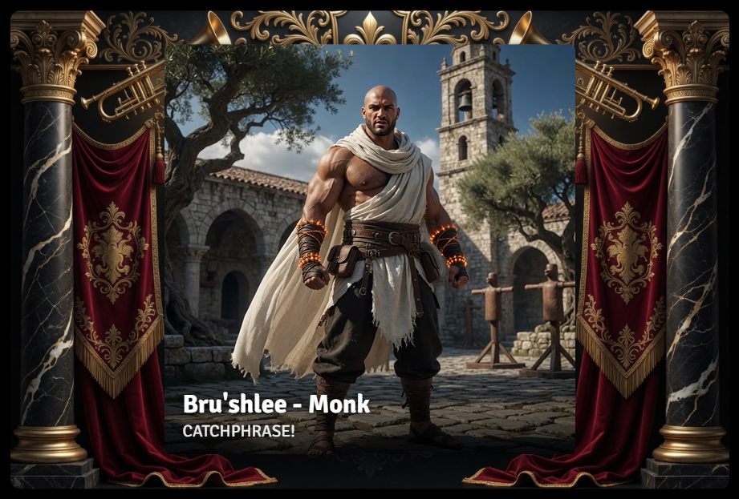

# Herald

Foundry VTT module for animated actor/NPC intro announcements. Slide, drop, or fade a token's portrait onto every player's screen with custom text and live actor data pulled straight from the actor sheet.

📸 **[Visual Guide](docs/GUIDE.md)** — screenshots of every part of the module, if you'd rather look than read.

---

## Features

**Trigger from Token HUD or the Actor Directory** — right-click a token or an actor in the sidebar. **Two universal templates** (PC / NPC) in **Herald — Settings**, plus optional **per-actor Template Override** on the Prototype Token config window. **Animated entrance**, optional **backdrop**, **`{{path}}` templating** with a field picker, **portrait video** support, **audio + volume**, **live preview**, and an optional **chat card** companion. **Card Size** is a shared world setting. **GM-only.**

See the [Visual Guide](docs/GUIDE.md) for labeled screenshots and step-by-step coverage of every field.

---

## Requirements

Requires Foundry VTT V14 (currently verified on **14.370**). Compatibility is capped at V14 until another major version is explicitly verified.

---

## Installation

Install via the module manifest URL in Foundry's Add-on Modules browser, or download and extract into your `Data/modules` folder.

---

## Quick start

1. **Configure Settings** — Foundry **Configure Settings** → **Herald — Settings** (PC and NPC tabs).
2. **Trigger** — Token HUD bullhorn icon, or Actor Directory context menu **Herald**.
3. **Optional overrides** — Prototype Token config title bar (clapperboard icon) for per-actor portrait source and template overrides.

Additional toggles in the core settings list: **Card Size**, **Post Chat Card**, **Compact Chat Image**, **Debug Logging**.

---

## Roadmap

- Stabilized macro/scripting API — `game.modules.get("herald").api` currently exists for internal testing during development and works, but hasn't been treated as a committed public surface (names/shapes could still change); a documented, stable version of this is planned but not yet finalized.
- D&D 5e field map — `SYSTEM_FIELDS` currently only has a PF2e entry; the core resolver/render pipeline is system-agnostic, but the field-picker's convenience dropdown needs real D&D 5e actor data verified the same rigorous way PF2e's was, not guessed paths.
- Optional foreground overlay image — a third layer (portrait sits behind it, not in front) for depth/framing effects beyond what the backdrop alone gives — e.g. a vignette or frame flourish that slightly occludes the portrait's edges. Purely additive: empty by default (nothing changes), populated only by GMs willing to design a webp with alpha transparency matching the backdrop's own dimensions. No forced pairing system — alignment is the GM's own responsibility when they opt in, same spirit as the existing backdrop image field. Once built, the Visual Guide should call out matching the backdrop's canvas dimensions as the practical way to get this to align.

---

## License

MIT
