# Herald — Visual Guide

A screenshot walkthrough of every part of the module, companion to the
main [README](../README.md). Sections follow the same order as the
README's quick-start flow: trigger surfaces, the animated card and chat
companion, template settings, then per-actor overrides.

Open **Herald — Settings** from Foundry's **Configure Settings** menu
(module settings list). The editor has **PC Template** and **NPC Template**
tabs; both save together when you click **Save**.

---

## Triggering

**Token HUD** — right-click a placed token (GM only), click the bullhorn
icon.

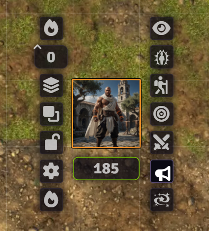

**Actor Directory** — right-click an actor in the sidebar (GM only),
click **Herald** in the context menu. Resolves against that actor's
`prototypeToken`, not a specific placed instance — for customized
unlinked tokens, use Token HUD on the placement you care about.

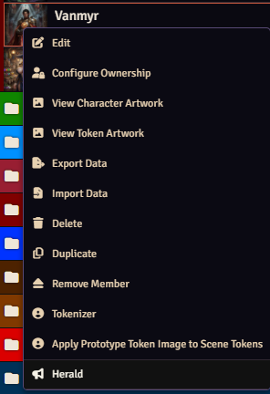

**The result** — the animated overlay card (portrait or video, message,
subtext, optional backdrop). Last trigger wins if one is already showing.

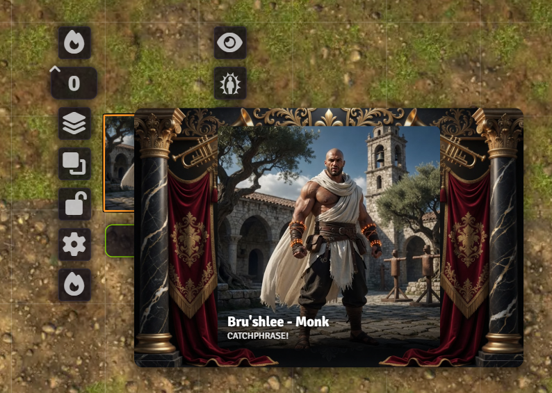

---

## Chat card companion

When **Post Chat Card** is enabled in Foundry's core settings list (on by
default), each trigger also posts a chat message with the portrait, resolved
message, and subtext. Video portraits embed with native controls and do not
autoplay in chat. **Image** portraits can be clicked to open Foundry's
`ImagePopout` locally (full size for whoever clicked).

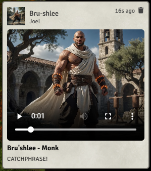

**Compact Chat Image** (core settings list, off by default) crops **image**
portraits in chat to a centered band; click the band to pop out the full
picture. Applies only to messages posted after you enable it.

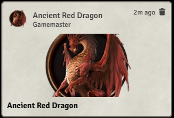

---

## Core module settings (Configure Settings list)

These live in the main Foundry settings list, not inside **Herald —
Settings**:

| Setting | Purpose |
|--------|---------|
| **Card Size** | Small / Medium / Large — shared for the whole world; scales the live overlay for everyone. |
| **Post Chat Card** | Toggle the chat companion on each trigger. |
| **Compact Chat Image** | Cropped chat image band (images only). |
| **Debug Logging** | Extra console output for template resolution (client scope). |

> **Screenshot note (Joel):** optional `images/guide/herald-core-settings-list.png`
showing the four entries in Configure Settings — not required for play, but
helps new GMs find **Card Size** vs the template editor button.

---

## Settings — Portrait Source

Global PC/NPC templates support **Avatar** or **Token** only. **Token**
uses whatever file is in the token texture slot (image or video, detected by
extension). Per-actor **Custom** paths are configured in **Template
Override** (below), not in the global template.

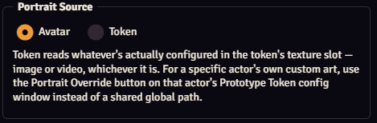

> **Screenshot note (Joel):** if this capture still shows **Custom** on the
global template, replace it — the live UI no longer offers Custom here.

---

## Settings — Message & Subtext

The field-picker dropdown inserts a `{{path}}` token at the cursor in the
adjacent text field; the custom-path box + **Insert** adds any path manually.
Message and Subtext share the same tooling.

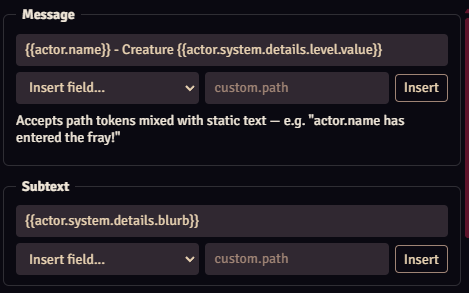

The next capture (`herald-template-settings-message-options.png`) was taken
for an older layout. It may show position or other controls; treat the live
form order (Portrait → Message → Subtext → Backdrop → Animation → Position →
Audio & Timing) as authoritative.

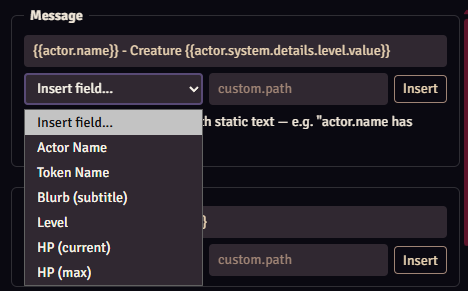

---

## Settings — Backdrop

**None**, **Color**, or **Image**, plus **Backdrop Shape** (Portrait /
Landscape / Square) when a backdrop is active.

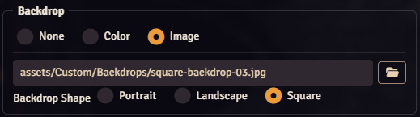

---

## Settings — Animation & Position

**Animation** — Slide Left, Slide Right, Drop In, or Fade. **Position** —
Center or a corner (select control).

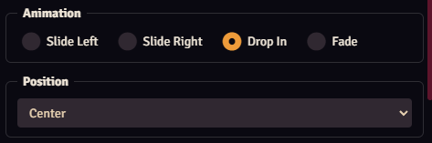

---

## Settings — Audio & Timing

Optional **Audio Track** (mutes the portrait video's own audio when set so
sources do not overlap). **Mute Audio** overrides everything. **Volume**
(0–100, default 50) applies to the track and to a portrait video's embedded
sound when that video is the sound source. **Duration (ms)** — `0` means
click the overlay card to dismiss.

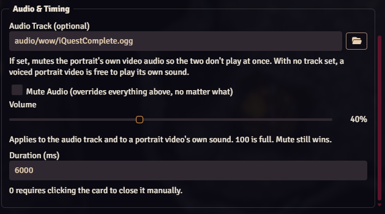

> **Screenshot note (Joel):** if this capture predates the **Volume** slider,
re-shoot **Audio & Timing** so the slider and percentage label appear.

---

## Settings — Preview & Save

**Preview** sits in the fixed footer (always visible): pick **Preview using**
(sample actor for the active tab), then **Preview** — resolves unsaved form
values on **your client only** via the same pipeline as a live trigger.
**Save** writes both PC and NPC templates.

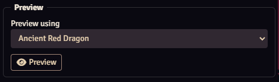

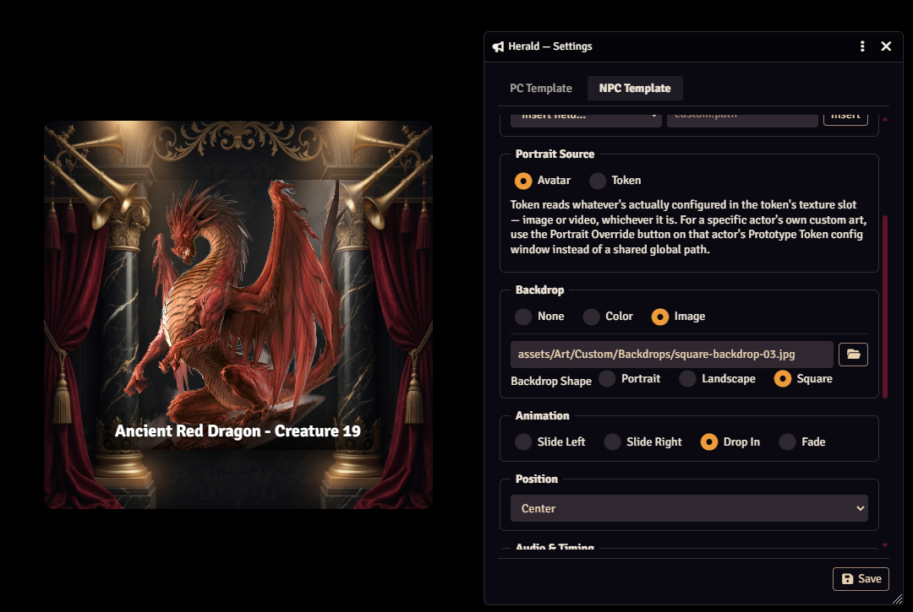

Unused assets you may still add to this section: `herald-template-settings-preview-using.png`,
`herald-template-settings-foundry.png`, `herald-template-settings-position-options.png`.

---

## Per-Actor Template Override

Open an actor's **Prototype Token** configuration (from the actor sheet), click
the clapperboard icon in that window's title bar. **Portrait Source** (Avatar /
Token / **Custom**) saves on **Save** even when **Override for &lt;actor&gt;** is
off. Check **Override for &lt;actor&gt;** to replace message, subtext, backdrop,
animation, position, audio, and timer for that actor only.

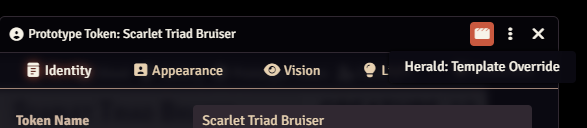

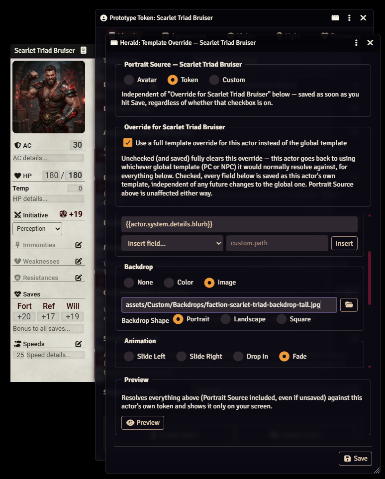

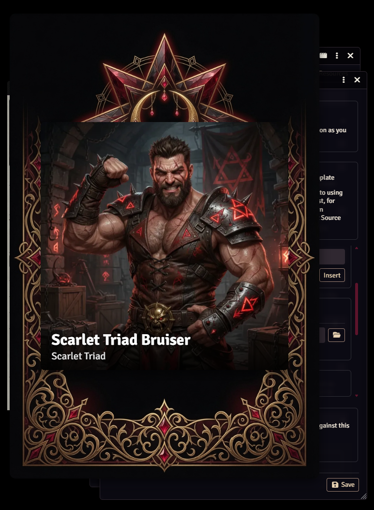

---

*Screenshots may lag slightly behind the latest UI copy. This guide and the
[README](../README.md) are kept in sync with code; replace any capture called
out in **Screenshot note (Joel)** blocks when you have a fresh shot.*
